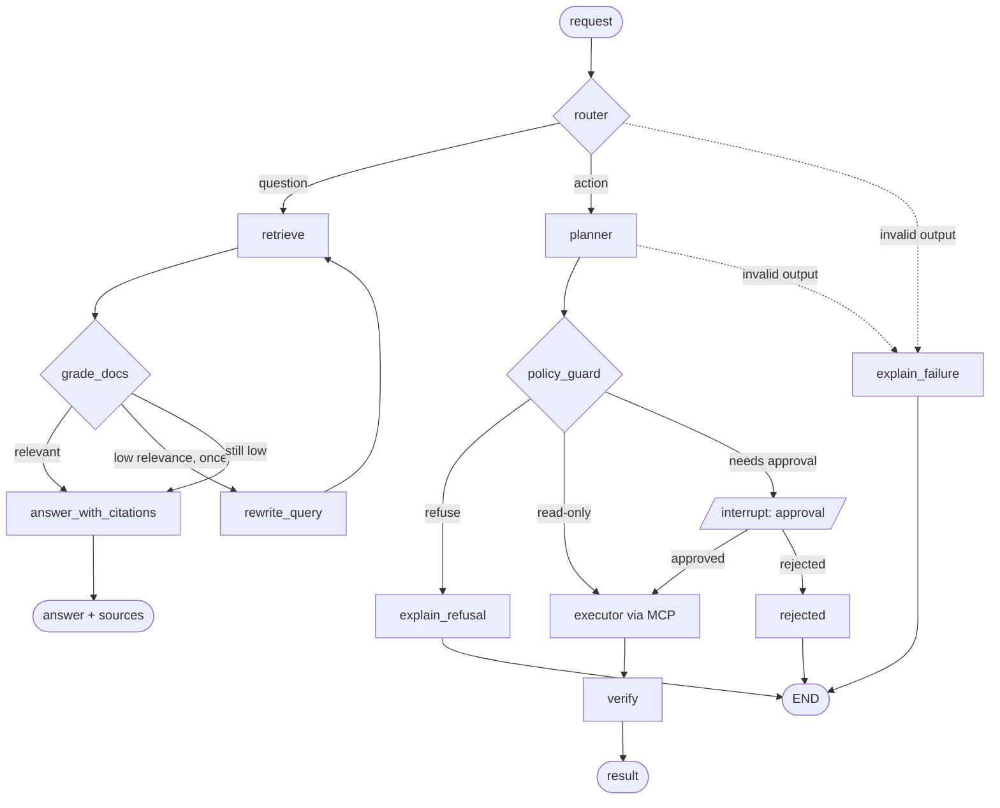

# InfraPilot

**A fully local LangGraph agent that turns natural-language infrastructure requests into
policy-checked, human-approved changes on a Docker sandbox.** No API keys, no cloud LLM, no data
leaving the machine: it runs on a laptop with [Ollama](https://ollama.com).

It demonstrates agentic AI engineering practices: orchestration, human-in-the-loop with `interrupt`,
deterministic guardrails, RAG with programmatically verified citations, observability and evals.

## How it works



## Quickstart

Prerequisites: Python 3.12, [uv](https://docs.astral.sh/uv/), Docker, and Ollama running on the host.

```bash
cp .env.example .env     # set LLM_MODEL to a model that fits your hardware
make install
make pull-models         # ollama pull for the configured chat + embedding models
make up                  # pgvector database + self-hosted Langfuse
make ingest              # embed docs/runbooks into pgvector
make ask Q="What is the naming convention for containers?"
make ask Q="Create an nginx container called ip-web with 256 MB and 0.5 CPU"
```

Action requests show a plan preview and wait for `y/N`. `make down` stops the stack.

## Why local-first

Prompts and infrastructure data stay on your machine (data sovereignty, GDPR), there is no per-token
cost, and it works offline. See [docs/EU_AI_ACT_NOTES.md](docs/EU_AI_ACT_NOTES.md).

## Design decisions

Full list in [docs/DECISIONS.md](docs/DECISIONS.md).

- **`interrupt` over prompt-based confirmation.** Asking the model "are you sure?" is a suggestion;
  `interrupt` suspends the graph at a checkpoint and resumes only with an explicit decision, which
  is persisted and bound to a hash of the exact plan.
- **Deterministic policy.** Allowlists, quotas and naming rules are plain Python with unit tests.
  The model proposes; code disposes. The executor re-checks everything before running anything.
- **MCP for tools.** The sandbox is a standalone FastMCP server. Tools are discoverable, swappable
  and testable without the agent, and the agent only sees what the server exposes.
- **Schema-constrained output, not tool calling.** Small local models are weak at function calling,
  so router, planner and grader use Ollama's JSON-schema output with validation and one retry.
  The model never invokes tools; the executor does.

## Hardware & models

| | |
|---|---|
| Tested config | _TODO: fill after benchmarking (CPU / GPU / RAM, model, `NUM_CTX`)_ |
| Minimum | _TODO_ |
| Expected latency | _TODO: router / planner / answer, p50_ |

Models (Q4, `NUM_CTX=8192`, approximate): `qwen3:8b` ~6-8 GB (default), `llama3.1:8b` ~6-8 GB,
`qwen3:4b` ~3-4 GB (smaller fallback), `qwen3:1.7b` ~2 GB (plumbing only).

## Evals

Deterministic and local-only (`make eval`, optionally `MODELS=qwen3:8b,llama3.1:8b`). The dataset
format is documented in `evals/run_evals.py`. Output starts with an auto-detected hardware line.

| model | routing acc | policy acc | plan-valid % | citation-valid % | refusal % | latency p50 | latency p95 | tokens/s |
|---|---|---|---|---|---|---|---|---|
| _TODO_ | | | | | | | | |

## Observability

Set `LANGFUSE_ENABLED=true`; traces appear at <http://localhost:3000>.

_Screenshot placeholder: `docs/img/langfuse-trace.png` (TODO)._

## Known limitations

- Reranking is a stub (`rag/retrieve.py`).
- Small models can misroute or produce invalid plans; failures end in `explain_failure`, never in execution.
- The LLM-judge is minimal. Benchmark numbers are not yet filled in.
- `scale_service` relies on container labels, not Swarm or Kubernetes.
- Single-user CLI: no authentication or multi-tenant isolation.

## Development

```bash
make lint typecheck test   # unit + integration with a FakeLLM, no network
```

CI runs the same; it never pulls or runs Ollama. License: MIT.
